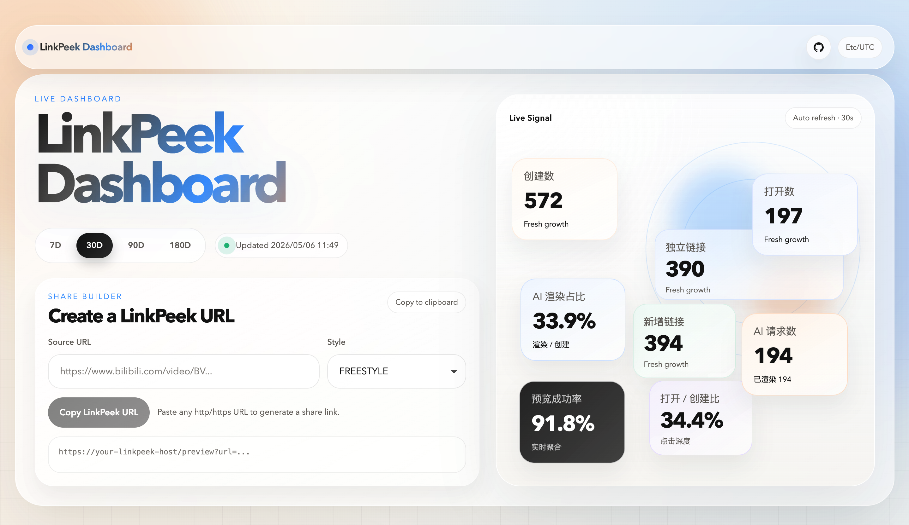
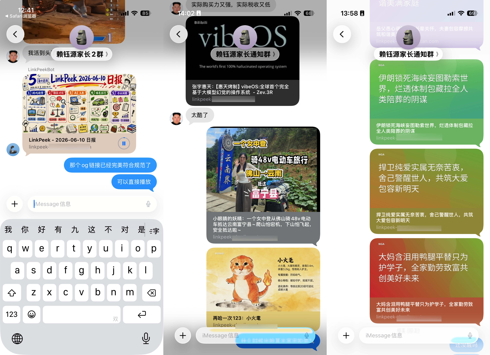
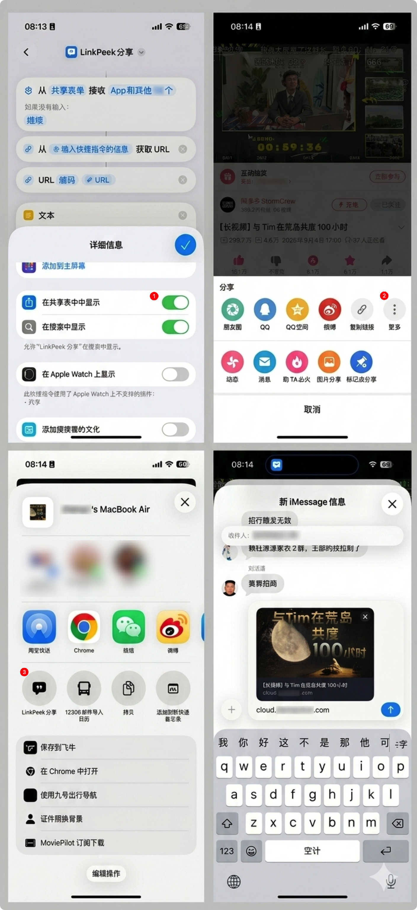

<p align="center">
  
</p>

<h1 align="center">LinkPeek</h1>

<p align="center">
  <strong>让分享到聊天里的链接，都有一张好看的预览卡片。</strong>
</p>

<p align="center">
  <a href="https://linkpeek.jianyutan.com/dashboard">在线体验</a> ·
  <a href="#快速开始">快速开始</a> ·
  <a href="docs/chrome-extension.md">Chrome 扩展</a> ·
  <a href="docs/linkpeek.sh">Raycast 脚本</a> ·
  <a href="https://www.icloud.com/shortcuts/5cce870e64ff48e0853bd77485191fa7">iOS 快捷指令</a>
</p>

<p align="center">
  <a href="https://github.com/shigella520/LinkPeek/actions/workflows/ci.yml"></a>
  <a href="LICENSE"></a>
  <a href="https://openjdk.org/projects/jdk/17/"></a>
  <a href="https://spring.io/projects/spring-boot"></a>
</p>

很多网站的链接发到 iMessage 等聊天软件里，只显示一个光秃秃的网址，或者预览卡片里是登录页、错误页。LinkPeek 是一个链接预览代理：把原始链接换成 LinkPeek 的分享链接，聊天软件抓取时会得到一张标题清楚、带封面图的预览卡片；朋友点开时，照常跳转到原始页面。

- **卡片稳定好看**：为 Bilibili、V2EX、NGA、LINUX DO、GapHub 生成标准的 Open Graph 预览，标题、描述、封面一应俱全。
- **AI 标题**：纯文字帖子可以按你设定的风格，由 AI 改写成一行更吸引人的标题。
- **分享总结**：按天、周、月把大家分享过的链接汇总成一份 AI 报告，自动配图、生成朗读音频，再推送到群里。
- **数据看板**：看谁分享了什么、打开了多少次、哪些链接最热门。
- **随手可用**：Dashboard、Chrome 扩展、Raycast 脚本和 iOS 快捷指令都能一键生成分享链接。

> 在线体验的管理密码是 `linkpeek`。在 Dashboard 连续按 3 下 `6` 会显示后台入口。

## 使用预览






## 支持的平台

| 平台 | 预览卡片 |
| --- | --- |
| Bilibili | 视频封面、标题和简介；可在后台开启 AI 标题 |
| V2EX | 话题标题卡片，支持 AI 标题 |
| NGA | 帖子标题卡片，支持 AI 标题；可在后台配置登录态 |
| LINUX DO | 主题标题卡片，支持 AI 标题；可在后台配置 Cookie |
| GapHub | 主题标题卡片，支持 AI 标题 |

其他平台可以按[新增平台](#新增平台)的方式扩展。

## 如何工作

1. 把原始链接交给 LinkPeek，得到 `https://你的域名/preview?url=<原始链接>` 形式的分享链接。
2. 聊天软件的抓取器访问这个链接时，LinkPeek 解析原始页面，返回带标题、描述和封面的 Open Graph 页面，聊天里就显示出预览卡片。结果会缓存，同一个链接不会反复抓取。
3. 真人点开链接时，LinkPeek 记录一次打开，然后跳转到原始页面。
4. 如果带了 `style` 参数，纯文字帖子会按对应风格由 AI 生成标题；AI 失败时自动退回原始标题，卡片照常可用。

## 快速开始

### 启动

使用 GHCR 上的镜像：

```bash
docker run -d --name linkpeek \
  -p 8080:8080 \
  -e BASE_URL=https://preview.example.com \
  -e TZ=Asia/Shanghai \
  -e STATS_ADMIN_PASSWORD=换成你的管理密码 \
  -v linkpeek-data:/data \
  ghcr.io/shigella520/linkpeek:latest
```

也可以用仓库里的 `docker-compose.yml` 从源码构建：

```bash
docker compose up -d --build
```

`BASE_URL` 必须是聊天软件能访问到的公网地址，建议使用 HTTPS。`/data` 保存缓存、数据库、分享资产和日志，需要持久化。

### 生成分享链接

最简单的方式是打开 `/dashboard`，粘贴原始链接，复制生成的分享链接。Dashboard 会先判断链接是否支持；不支持的链接可以直接复制原链接。

也可以自己拼：把原始链接 URL 编码后放到 `url` 参数里：

```text
https://preview.example.com/preview?url=https%3A%2F%2Fwww.v2ex.com%2Ft%2F1206093
```

想让 AI 改写标题，追加 `style` 参数。`style` 对应后台配置的风格；`FREESTYLE` 表示随机挑一种：

```text
https://preview.example.com/preview?url=https%3A%2F%2Fwww.v2ex.com%2Ft%2F1206093&style=FREESTYLE
```

### 其他入口

- **Chrome 扩展**：在网页上按快捷键（macOS 默认 `Command+Shift+L`）生成当前页面的分享链接，还可以把登录 Cookie 同步给 LinkPeek。安装和配置见 [Chrome 扩展配置文档](docs/chrome-extension.md)。
- **Raycast 脚本**：[linkpeek.sh](docs/linkpeek.sh)。复制原始链接后运行，分享链接会直接放回剪贴板。自部署时改脚本开头的 `base_url`。
- **iOS 快捷指令**：[安装快捷指令](https://www.icloud.com/shortcuts/5cce870e64ff48e0853bd77485191fa7)。在 App 的分享菜单里点“LinkPeek 分享”，生成链接后直接打开 iMessage。

<p align="center"></p>

### 常用地址

| 地址 | 用途 |
| --- | --- |
| `/dashboard` | 数据看板和分享链接生成器 |
| `/admin/login` | 管理后台 |
| `/preview?url=...&style=...` | 分享链接 |
| `/api/preview/support?url=...` | 判断链接是否支持预览 |
| `/api/preview/styles` | 查询可用的风格 |
| `/api/health` | 健康检查 |
| `/doc.html` | 接口文档 |

## 功能说明

### AI 标题

在后台的“提示词设置”里，为每种风格写一段提示词（例如“标题党”“新闻腔”“文艺”），再在“AI 服务配置”里添加一个或多个 AI 服务。

- 分享链接带上 `style=风格名` 就会使用对应风格；`FREESTYLE` 会随机选一种。
- 多个 AI 服务按顺序依次尝试，前一个失败自动换下一个；可开启自动降级，把连续失败的服务挪到最后。
- 不同风格的标题分开缓存，互不影响。
- Bilibili 这类本身有封面的卡片默认使用原始标题和封面，可在后台单独开启 AI 标题。

### 分享总结

在后台“分享总结”里创建每日、每周或每月任务。到点后，LinkPeek 汇总这段时间大家分享过的链接，由 AI 写成一份报告。每份报告可以：

- 自动生成一张 AI 分享图，并配一个公开的报告分享页，发到聊天里也是带封面的卡片；
- 自动生成朗读音频，分享页上可以直接播放；
- 通过 Webhook 推送出去，例如发到 BlueBubbles，让机器人自动发到群里。

报告可以重新生成，分享链接保持不变。

### Webhook 通知

在后台“通知管理”里配置通知渠道和通知任务，事件发生时向外部系统发送请求。可选事件：

| 事件 | 触发时机 |
| --- | --- |
| `SHARE_SUMMARY_IMAGE_SUCCESS` | 分享总结配图生成成功 |
| `SHARE_SUMMARY_IMAGE_FAILED` | 分享总结配图生成失败 |
| `SHARE_SUMMARY_AUDIO_FAILED` | 分享总结音频生成失败 |
| `AI_PROVIDER_REQUEST_FAILED` | AI 服务请求失败 |
| `AI_PROVIDER_AUTO_DOWNGRADED` | AI 服务被自动降级 |
| `DATA_CRAWL_REQUEST_FAILED` | 抓取原始页面失败 |

请求支持自定义 Header 和 Body 模板（只能使用该事件提供的占位符）、HMAC-SHA256 签名，失败自动重试，最多 3 次，发送记录可在后台查看和重发。

为了安全，默认不允许向内网地址发送。如果要发给局域网里的 BlueBubbles 等服务，设置环境变量放行对应主机：

```yaml
WEBHOOK_ALLOWED_PRIVATE_HOSTS: "192.168.31.11"
```

多个主机用逗号分隔，填 IP 或域名，不含协议、端口和路径，不支持通配符或网段。修改后需要重建容器。

### 管理后台

访问 `/admin/login`，用 `STATS_ADMIN_PASSWORD` 登录（不设置这个变量时后台关闭）。后台包括：

- **提示词设置**：标题格式要求和各个风格的提示词。
- **AI 服务配置**：AI 服务、模型、超时、排序、连通性测试和自动降级。
- **平台配置**：Bilibili 的 AI 标题开关、LINUX DO 的 Cookie、NGA 的登录态。
- **分享总结**：报告列表、定时任务、配图和朗读的服务配置。
- **通知管理**：通知渠道、通知任务、发送记录。
- **服务日志和预览事件**：查看日志、清理缓存、查看和清理统计数据。

连续输错密码会被暂时锁定，时间逐次加倍，最长 15 分钟。

## 配置项

部署相关的配置通过环境变量设置；提示词、AI 服务、平台 Cookie、分享总结和通知都在管理后台配置。

| 变量名 | 默认值 | 说明 |
| --- | --- | --- |
| `BASE_URL` | `http://localhost:8080` | 服务对外地址，分享链接和图片地址都用它 |
| `PORT` | `8080` | 监听端口 |
| `TZ` | 系统时区 | 时区，影响统计和分享总结的日期 |
| `STATS_ADMIN_PASSWORD` | 空 | 管理后台密码，设置后启用后台 |
| `ADMIN_COOKIE_SECURE` | `auto` | 后台登录 Cookie 的 Secure 属性；`auto` 在 `BASE_URL` 为 https 时开启 |
| `CACHE_DIR` | `/data/cache` | 缓存和分享资产目录 |
| `STATS_DB_PATH` | `/data/stats/linkpeek.db` | SQLite 数据库路径 |
| `CACHE_TTL_SECONDS` | `86400` | 预览信息和封面的缓存时间（秒） |
| `CACHE_MAX_SIZE_GB` | `10` | 缓存空间上限 |
| `STATS_RETENTION_DAYS` | `180` | 统计数据保留天数 |
| `DOWNLOAD_TIMEOUT` | `120s` | 抓取原始页面和下载图片的超时 |
| `PREVIEW_WARMUP_ENABLED` | `true` | 真人打开链接后，是否在后台提前抓取预览信息 |
| `PREVIEW_WARMUP_THREADS` | `2` | 提前抓取的线程数 |
| `PREVIEW_WARMUP_QUEUE_CAPACITY` | `64` | 提前抓取的队列上限 |
| `WEBHOOK_ALLOWED_PRIVATE_HOSTS` | 空 | 允许 Webhook 访问的内网主机，逗号分隔 |
| `WEB_ICON_PATH` | 空 | 自定义网页图标文件路径 |
| `LOG_LEVEL` | `INFO` | 日志级别 |
| `LOG_FILE_PATH` | `/data/logs/linkpeek.log` | 日志文件路径，后台日志页也读取它 |
| `LOG_FILE_MAX_SIZE` | `10MB` | 单个日志文件上限 |
| `LOG_FILE_MAX_HISTORY` | `14` | 日志文件保留数量 |
| `LOG_FILE_TOTAL_SIZE_CAP` | `200MB` | 日志总大小上限 |
| `STATS_EVENT_DEDUPE_TTL` | `2m` | 统计事件去重时间窗口 |
| `STATS_EVENT_DEDUPE_MAX_ENTRIES` | `10000` | 统计事件去重的最大条目数 |
| `VIDEO_MAX_QUALITY` | `480` | 预留的视频能力最高清晰度 |

## 部署建议

- 通过公网 HTTPS 提供服务，聊天软件抓取预览的成功率更高。
- 前面放一层 Nginx 等反向代理，负责 TLS、访问日志和基础限流。
- 整个 `/data` 目录持久化，避免重建容器后缓存、数据库、分享图片、音频和日志丢失。
- 管理后台、数据库、日志和 `/data` 目录按生产权限保护：里面有 Cookie、AI Key 和 Webhook 密钥。

## 新增平台

每个平台是一个独立模块，实现 `PreviewProvider` 接口：

1. 实现 `supports()`（只做快速的网址判断，Dashboard 和 Raycast 脚本都靠它判断是否支持）、`canonicalize()` 和 `resolve()`。
2. 想支持 AI 标题，提供 `rawContent` 或覆盖 `enrichForAiTitle()` / `supportsAiTitle()`。
3. 需要封面等媒体时，覆盖 `downloadThumbnail()` 或 `downloadVideo()`。
4. 在 `linkpeek-server` 中注册为 Spring Bean，并为网址匹配、规范化、解析和媒体下载补上测试。

可以从 [TemplatePreviewProvider](./linkpeek-provider-template/src/main/java/io/github/shigella520/linkpeek/provider/template/TemplatePreviewProvider.java) 开始，详细说明见 [Provider 开发指南](./docs/provider-development.md)。

## 本地开发

```bash
./mvnw -B verify    # 构建并运行测试

./scripts/start-dev.sh   # 启动本地服务，管理密码 test，数据放在 .cache/linkpeek-dev
```

项目结构：

| 模块 | 内容 |
| --- | --- |
| `linkpeek-core` | 核心模型、网址规范化和平台扩展接口 |
| `linkpeek-provider-*` | 各平台的网址识别、解析和封面下载 |
| `linkpeek-provider-template` | 新增平台的模板 |
| `linkpeek-server` | Spring Boot 服务：预览、缓存、统计、Dashboard、管理后台、AI 标题、分享总结和通知 |
| `extensions/linkpeek-chrome` | Chrome 扩展 |

更多文档：

- [架构说明](./docs/architecture.md)
- [数据库表结构](./docs/database-schema.md)
- [Provider 开发指南](./docs/provider-development.md)
- [DEV 镜像发布指南](./docs/publish-dev-image-workflow.md)

## 常见问题：`PKIX path building failed`

如果日志里出现：

```text
javax.net.ssl.SSLHandshakeException: PKIX path building failed
```

一般不是 LinkPeek 的问题，而是 Java 不信任当前的 HTTPS 证书链。常见原因是开着公司或校园网代理，或者 Clash、Surge、Charles 之类的 HTTPS 代理和抓包工具（`curl` 用系统证书，Java 用自己的证书库，所以 `curl` 正常而 Java 报错）。

按顺序尝试：

1. 关掉系统代理、抓包工具或 HTTPS 中间人代理后重试。
2. 必须经过代理时，把代理的根证书导出为 `ca.crt`，导入 JDK 证书库（默认密码通常是 `changeit`）：

   ```bash
   keytool -importcert \
     -alias local-proxy-ca \
     -file /path/to/ca.crt \
     -keystore "$JAVA_HOME/lib/security/cacerts"
   ```

3. 不想改全局 JDK 时，启动时单独指定证书库：

   ```bash
   ./mvnw -pl linkpeek-server -am spring-boot:run \
     -Dspring-boot.run.jvmArguments='-Djavax.net.ssl.trustStore=/path/to/truststore.jks -Djavax.net.ssl.trustStorePassword=changeit'
   ```

4. 验证是否恢复：

   ```bash
   curl -A "facebookexternalhit/1.1" \
     "http://localhost:8080/preview?url=https%3A%2F%2Fwww.bilibili.com%2Fvideo%2FBV1McSQBEE71"
   ```

   不再返回 `Preview Error` 就说明解决了。

## 许可证

LinkPeek 使用 [MIT License](LICENSE) 开源，可自由使用、修改、分发和商用，但需保留原始版权声明和许可证文本。

## 友情链接

<p align="center">
  <a href="https://linux.do" target="_blank">
    
  </a>
</p>
